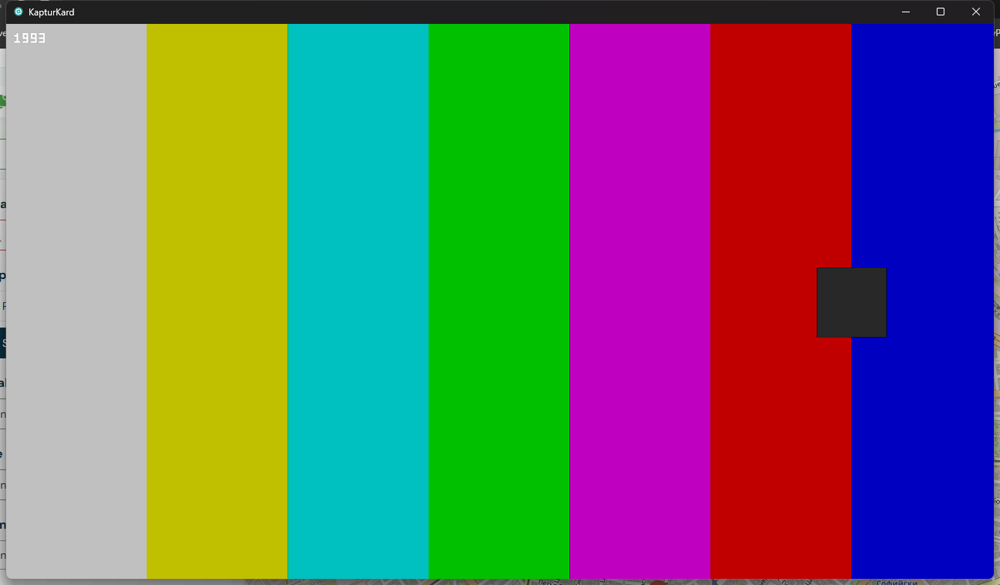
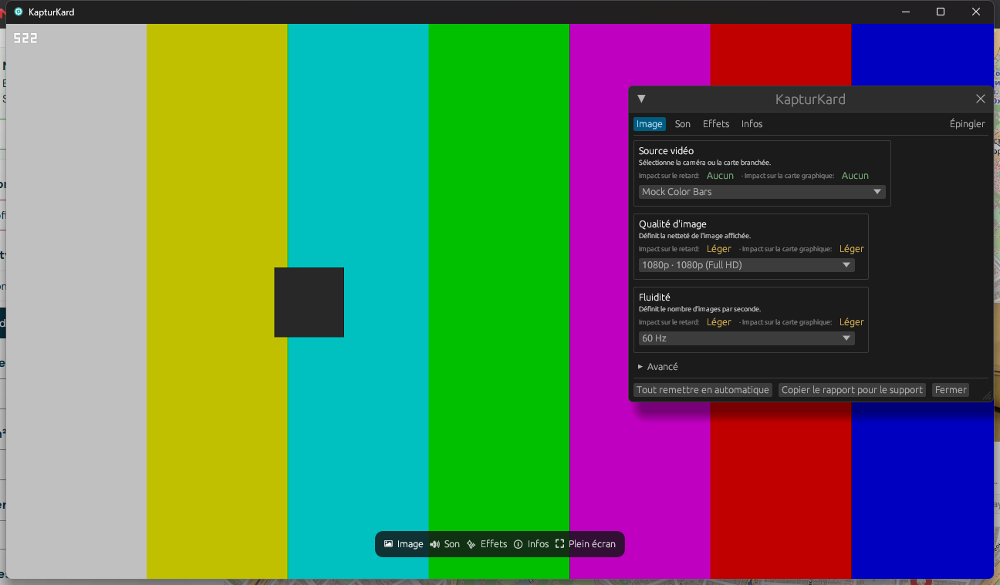
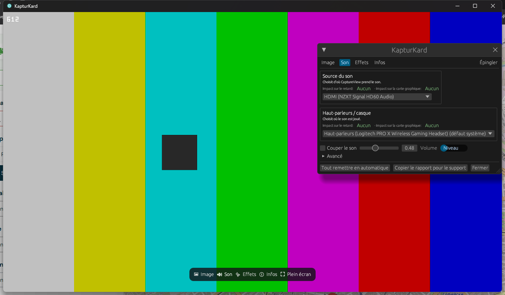
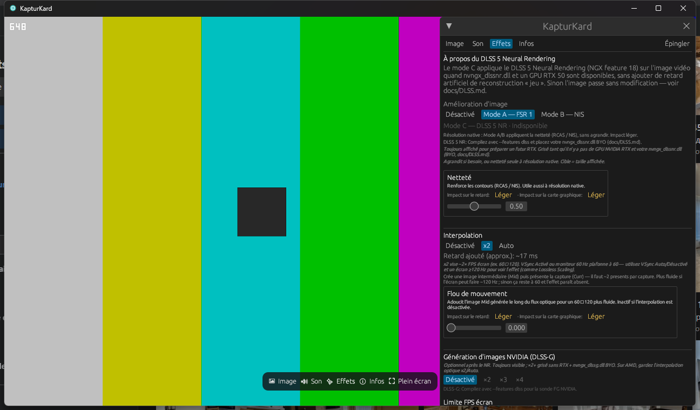
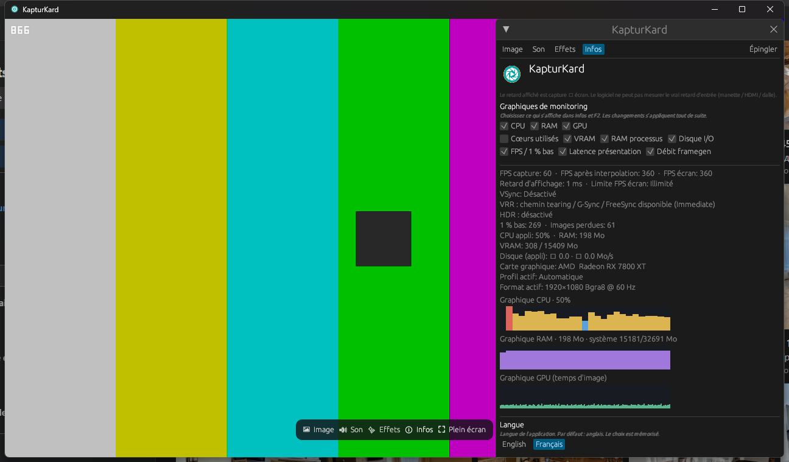
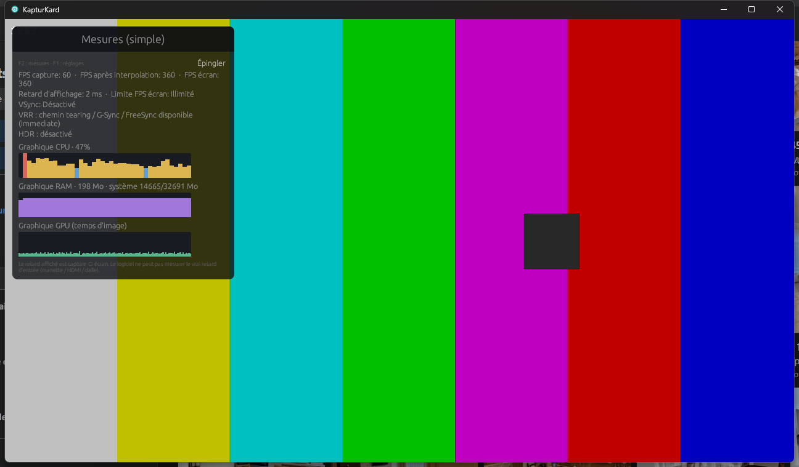
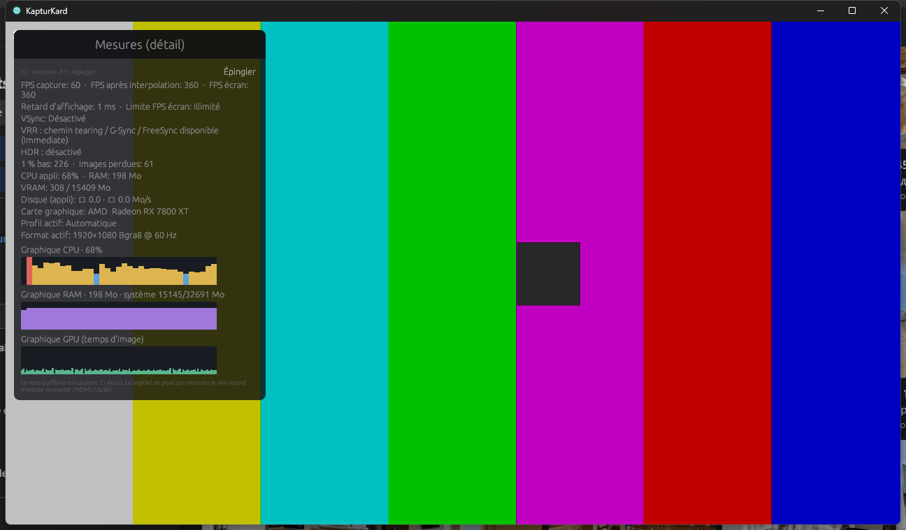

# CaptureView

Desktop preview app for generic UVC / capture-card sources. Product / window name **KapturKard**; workspace/binary crate **`captureview`**; repository folder **`kaptur-kard`**. Brand mark: `assets/kapturkard-logo.png` (Windows `.ico` embedded in the exe).

## Screenshots / Captures d’écran

Captured from a Windows release build (`captureview.exe`) with the mock color-bars source. UI shown in **French** (switch language under **Infos**).  
Captures prises depuis un build release Windows avec la source mock. Interface en **français** (langue changeable dans **Infos**).

### Preview / Aperçu

Mock 1080p @ 60 Hz preview (frame counter from the synthetic source).  
Aperçu mock 1080p @ 60 Hz (compteur de frames de la source synthétique).



### Image settings / Réglages Image

Source, resolution (**Qualité d’image**), refresh (**Fluidité**), plus impact hints (latency / GPU). Floating toolbar: Image · Son · Effets · Infos · Plein écran.  
Source, résolution, fluidité, et indicateurs d’impact (retard / GPU). Barre flottante : Image · Son · Effets · Infos · Plein écran.



### Sound / Son

HDMI capture audio in, speakers/headset out, mute, volume, and level meter.  
Entrée audio HDMI, sortie casque/haut-parleurs, mute, volume et niveau.



### Effects — FSR / frame gen / Effets

**Mode A — FSR 1**, sharpness (RCAS), optical-flow **interpolation x2**, motion blur, DLSS-G multipliers (RTX path; greyed on AMD), display FPS limit.  
**Mode A — FSR 1**, netteté (RCAS), **interpolation x2**, flou de mouvement, multiplicateurs DLSS-G (chemin RTX ; grisé sur AMD), limite FPS écran.



### Infos — monitoring graphs, VRR / HDR, language

**Graphiques de monitoring** toggles (CPU/RAM/GPU, VRAM, disk I/O, FPS / 1% lows, present latency, framegen throughput), live sparklines, FPS (capture / after interpolation / display), pipeline delay, VSync, **VRR** (G-Sync / FreeSync), **HDR** status, language (English / Français).  
Cases **Graphiques de monitoring**, courbes live, FPS, retard pipeline, VSync, **VRR**, statut **HDR**, choix de langue.



### Metrics overlay (F2) / Mesures

**Simple** and **Detailed** overlays — VRR/HDR lines; detailed mode adds CPU/RAM/VRAM graphs and frame-time history.  
Overlays **simple** et **détail** — lignes VRR/HDR ; le détail ajoute les graphiques CPU/RAM/VRAM et l’historique des temps d’image.

| Simple | Detailed / Détail |
|--------|-------------------|
|  |  |

## Status

**Step (h)** — extended compatibility (last planned brief step).

| Area | Status |
|------|--------|
| Bob deinterlace (Auto / Off / Bob) | **Done** — Auto when mode is interlaced (480i / 576i / 1080i) |
| Windows Media Foundation | **Done** — primary capture path |
| DirectShow fallback | **Partial** — feature-gated scaffolding (`--features directshow`); empty enum until DS graph lands |
| Linux V4L2 | **Done (structure)** — real `v4l` crate list/start/stop; build/test on Linux |
| macOS AVFoundation | **Stub** — `cfg(macos)` scaffolding; compile on Apple hosts |
| Hot-plug (~2 s poll) | **Done** — reconnect last settings by device id |
| Frame interp / FSR1 / NIS / audio / metrics | **Done** (steps c–g) |
| VRR (G-Sync / FreeSync) + HDR output | **Done** — Immediate/Mailbox present, scRGB when Windows HDR on — [docs/VRR-HDR.md](./docs/VRR-HDR.md) |
| DLSS 5 NR Mode C + DLSS-G probe | **Wired / FG pending present hook** — BYO DLLs, RTX path kept for future users; AMD refuses cleanly — [docs/DLSS.md](./docs/DLSS.md) |
| Profiles / HUD / replay / LUT / health / updates | **Done (v0.3)** — Stream·Edit·Low-latency, F3 HUD, F9 replay, calibration, capture health, GitHub update check |
| Spout / NDI export | **Probe + prefs** — BYO runtimes — [docs/EXPORT.md](./docs/EXPORT.md) |

## Platform matrix

| OS | Video backend | Build notes |
|----|---------------|-------------|
| Windows 10/11 | Media Foundation (primary) | `cargo run -p captureview` — tested host for this project |
| Windows | DirectShow (optional) | `cargo run -p captureview --features directshow` — scaffolding only |
| Linux | V4L2 (`v4l` crate) | `cargo build -p capture` / `cargo run -p captureview` on a Linux host with `/dev/video*` |
| macOS | AVFoundation scaffolding | Compiles on Apple targets; capture start returns Unsupported until AVF I/O is wired |

Mock source is always available for CI and card-free development.

## Build & run

```powershell
cd c:\Users\kingd\Documents\GitHub\kaptur-kard
cargo run -p captureview
cargo build --release -p captureview
cargo test --workspace

# Optional: DLSS 5 Neural Rendering (nvngx_dlssnr.dll not vendored — docs/DLSS.md)
powershell -ExecutionPolicy Bypass -File native\dlss5-nr\build_native.ps1
cargo run -p captureview --features dlss
```

## Language

UI strings live in `locales/en.toml` and `locales/fr.toml`. **Default is English.** Switch in **Infos** (F1 → Infos); the choice is saved in `%APPDATA%\CaptureView\ui.toml` (`ui_language`).

## Logs

CaptureView writes **tracing** logs to a daily rotating file (and to stderr when a console is attached):

`%APPDATA%\CaptureView\logs\captureview.YYYY-MM-DD.log`

- Default level: **info** (Infos tab can change it; persisted in `ui.toml`).
- Override with `RUST_LOG` (e.g. `RUST_LOG=debug`).
- **Copy report for support** includes the log path and a tail of the file.
- Older files are pruned (keeps ~14 days).
- **Windows release** builds use `windows_subsystem = "windows"` (no console window). File logging still works. For a release build *with* a console: `cargo build --release -p captureview --features console`. Debug `cargo run` always shows a console.

### Linux

```bash
cargo build -p capture
cargo run -p captureview
# Needs a V4L2-capable system; libv4l headers if linking system libs.
```

### macOS

```bash
cargo build -p capture --target aarch64-apple-darwin
# On an Apple host: cargo run -p captureview
# Capture remains scaffolding until AVFoundation is implemented.
```

## Shortcuts (QOL)

| Key | Action |
|-----|--------|
| F1 | Settings |
| F2 | Metrics overlay |
| F3 | Compact HUD (FPS / 1% low / latency) |
| F9 | Save replay clip |
| F11 | Full screen |

## Effects pipeline

upload → color convert → **deinterlace (Bob)** → **interpolate** → **upscale (FSR1 / NIS / DLSS)** → present (+ light calibration)

- **Deinterlace**: Auto (default) enables Bob when the active format is flagged interlaced; user can force Off or Bob.
- **Interpolation**: Off / x2 / Auto (~one source frame of added delay when on).
- **Upscale**: Off / FSR 1 / NIS / **DLSS 5 NR** (Mode C). Mode C runs NGX feature 18 when the runtime + RTX 50 allow it; otherwise pass-through — see [docs/DLSS.md](./docs/DLSS.md).

## Lag measurement method

Software cannot measure true end-to-end input lag (controller → console → HDMI → panel). CaptureView reports:

1. **Pipeline delay** — capture timestamp → present (app-internal).
2. **Manual lag test (Info / F2)** — white flash + human stopwatch helper; not a hardware measurement.

Use an external LED / high-speed camera / dedicated lag tester for absolute HDMI lag.

## Tested cards / limits

| Item | Notes |
|------|--------|
| Host | Windows (this repo’s primary CI/dev machine) |
| Mock | Always works (synthetic YUY2) |
| UVC / capture cards via MF | Enumerated when Windows exposes them to Media Foundation |
| Interlaced | Heuristic + MF interlace flag; Bob GPU path needs compute shaders |
| DirectShow-only cards | Not captured yet — enable feature for future work; prefer MF |
| Linux / macOS capture | Code present; runtime verification belongs on those OS hosts |

## Out of scope

- Full DirectShow sample-grabber graph
- Production AVFoundation capture
- Bundling proprietary `nvngx_dlssnr.dll` (user must supply)
- FSR 2 / FSR 3
- Hardware lag meters

## Releases

Prebuilt binaries (Windows / Linux / macOS) are published on the GitHub Releases page for this repository. Local packaging on Windows:

```powershell
.\scripts\package-windows.ps1
```

CI workflow: `.github/workflows/release.yml` (tag `v*` or `workflow_dispatch`).

## What’s next

1. Finish DirectShow for MF-missing Windows cards (real filter graph).
2. Complete macOS AVFoundation device I/O.
3. Expand Linux V4L2 format probing / MJPEG decode path on real hardware.
4. Optional: field-aware deinterlace (weave / motion-adaptive) beyond Bob.

## Licence

MIT — see [LICENSE](./LICENSE). Third-party shader ports: see `licenses/`.
